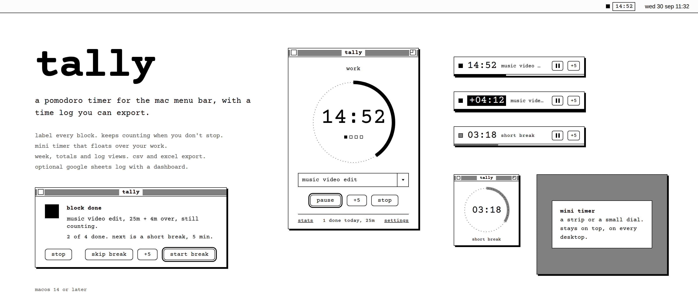

# tally

Pomodoro timer for the menu bar, with a time log you can export.

Black on white, lower case, set in Courier Prime (bundled, SIL Open Font License, see Tally/Fonts/OFL.txt).

## Build

1. Open `Tally.xcodeproj` in Xcode.
2. Product → Run (⌘R). It signs locally, no developer account needed.
3. To keep it: Product → Show Build Folder in Finder → Products → Debug, drag tally.app to Applications.
4. Allow notifications when asked. In System Settings → Notifications → tally, set the style to Alerts so the Start break / +5 / Skip buttons stay on screen until you click one.

## Reinstalling over an older copy

1. Quit the running copy (menu bar item → quit tally).
2. Delete the old Tally.app (or tally.app) from Applications. Deleting first matters when only the capitalisation has changed, otherwise macOS can keep the old name.
3. Build this project and drag the new tally.app into Applications.

The log, settings and Sheets connection are kept. They live outside the app.

## Using it

- Type what the block is for before or during it. Recent labels come up as you type, or from the arrow.
- +5 works mid-block or when a block ends. Either way it stays one entry in the log.
- When a block ends, a pop-up comes up over everything, full-screen apps included. start break, +5, skip break (saves and starts the next work block straight away) or stop (saves and ends). Return and Esc work. Turn it off in settings to get a plain notification instead.
- Red in the menu bar while working: switch it on in settings. Only a running work block is red; breaks and idle stay black/white.
- Rename in stats: click a label in the log, right-click a block in the week view, or use rename on a label's summary card (renames every block with that label).
- Stopping a block early logs it as "stopped early" if it ran for at least a minute.
- Stats (⌘2): week timeline, totals per day and per label, and the full log. Right-click a log row to rename or delete it.
- The name dropdown next to export narrows every stats view to one label. Totals then shows that label's week, all-time total and first logged date, and export only exports that label.
- Export from the Stats window: the week shown, this month, or everything, as CSV or Excel. The Excel file has a Log sheet and a By label sheet.

The log is kept at `~/Library/Application Support/tally/log.json`.

## Google Sheets (optional)

1. Make a new Google Sheet.
2. Extensions → Apps Script. Delete what's there and paste in `AppsScript/Code.gs` (or use Copy Apps Script in tally's settings).
3. Deploy → New deployment → type: Web app. Execute as: Me. Who has access: Anyone. Authorise when asked.
4. Copy the web app URL into tally's settings and press Test.

From then on every finished block is added as a row. Offline rows are held and sent later. Send full history backfills anything logged before you connected; rows already in the sheet are skipped. Renames are sent to the sheet too (with the latest script). Deletes aren't. If you set up the sheet with an older version of the script, paste the new one in, then Deploy → Manage deployments → edit → Version: new version. The URL stays the same.

The URL is the only key, so keep it private.
